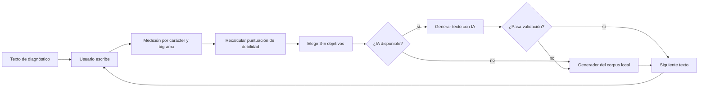
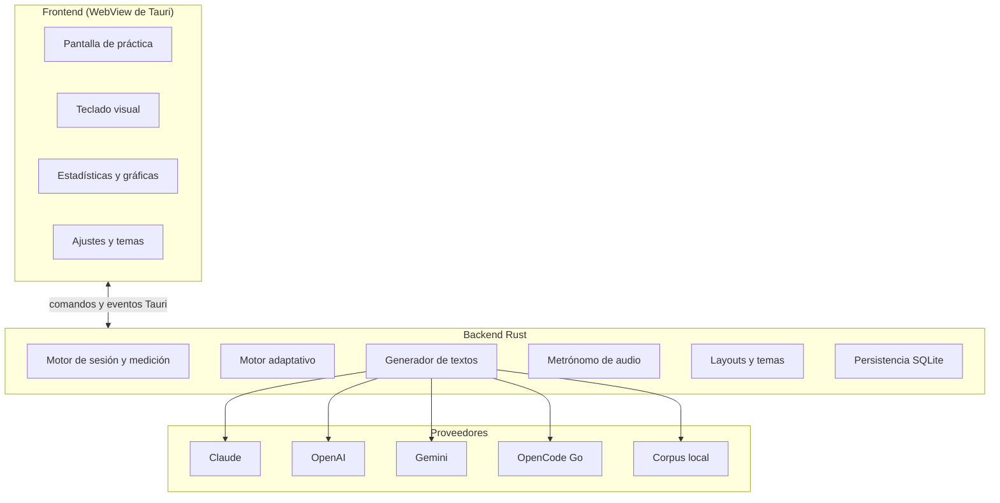

# PRD — PlexusTyping: tutor de mecanografía adaptativo con IA

**Versión:** 0.1 (borrador) · **Fecha:** 16-11-2026 · **Stack:** Rust + Tauri

---

## 1. Resumen y visión

**PlexusTyping** es una app de escritorio en Rust + Tauri que enseña mecanografía adaptándose a cada usuario. Empieza con un texto de diagnóstico, mide en qué caracteres falla o va lento, y pide a una IA textos nuevos cargados con esos caracteres. Funciona con **Claude, OpenAI, Google Gemini y OpenCode Go**, y sin conexión tira de un corpus local.

La diferencia frente a Monkeytype, Keybr o TypingClub: los textos no son aleatorios ni listas fijas. Son frases con sentido (o código real), en el idioma del usuario, generadas a medida de sus debilidades. Además incluye teclado visual opcional, contador de pulsaciones en vivo, metrónomo para entrenar ritmo constante, modo código y temas al estilo VS Code.

### Nombre

**PlexusTyping** = *plexus* + *typing*. El plexo braquial es la red de nervios que mueve hombros, brazos y manos: justo lo que se entrena al teclear. Sugiere conexión entre cerebro y dedos, y la parte de «red» encaja con el motor adaptativo de IA.

- **Nombre visible:** PlexusTyping (P y T en mayúscula).
- **Identificadores técnicos:** `plexustyping` en minúsculas (crates, binario, carpeta de datos, bundle id `com.plexustyping.app`).
- **Eslogan propuesto:** «Del cerebro a los dedos».

> Pendiente: confirmar que `plexustyping` está libre en crates.io, GitHub y como dominio (.com / .app / .dev), y buscar la marca en OEPM/EUIPO.

---

## 2. Objetivos, no-objetivos y métricas

### Objetivos

1. Reducir la tasa de error en los caracteres débiles de cada usuario, medible sesión a sesión.
2. Generar textos con sentido, en el idioma elegido, que concentren los caracteres débiles.
3. Dejar elegir proveedor de IA (Claude, OpenAI, Gemini, OpenCode Go) con la clave del propio usuario.
4. Funcionar sin IA ni conexión gracias a un corpus local.
5. Entrenar ritmo con un metrónomo fijo o adaptativo.
6. Practicar programación con un modo código para los lenguajes más usados.

### No-objetivos (v1)

- Competición online, rankings o multijugador.
- Sincronización en la nube entre dispositivos.
- Versión móvil.
- Backend propio que haga de proxy de las APIs: las claves son del usuario.

### Métricas de éxito

| Métrica | Objetivo |
| --- | --- |
| Error medio en los 5 caracteres más débiles | −50 % tras 10 sesiones |
| PPM (palabras por minuto) netas | +20 % tras 20 sesiones |
| Latencia hasta mostrar el siguiente texto | < 2 s (precarga en segundo plano) |
| Retraso entre tecla y pintado en pantalla | < 16 ms |
| Textos de IA que cumplen la densidad pedida de caracteres débiles | ≥ 90 % |

---

## 3. Usuarios y casos de uso

| Perfil | Necesidad | Cómo lo cubre |
| --- | --- | --- |
| Principiante | Aprender dónde está cada tecla sin mirar | Teclado visual con dedo sugerido, ritmo lento con metrónomo |
| Usuario intermedio | Quitarse errores fijos (ñ, tildes, ¿¡, mayúsculas) | Textos de IA cargados con sus caracteres débiles |
| Programador | Practicar símbolos (`{}[]<>;=`) | Modo código con los lenguajes más usados |
| Usuario de layout alternativo | Migrar a Dvorak, Colemak, etc. | Layouts por fichero y teclado visual del layout elegido |
| Profesor o familia | Varios alumnos en un mismo equipo | Perfiles locales independientes |

### Casos de uso clave

1. **Primera vez:** elige idioma y layout, hace el texto de diagnóstico y ve su mapa de calor de errores.
2. **Sesión diaria:** encadena textos adaptativos de 1 a 3 minutos hasta cumplir su meta del día.
3. **Ritmo:** activa el metrónomo a 60 BPM y deja que suba solo mientras mantenga la precisión.
4. **Código:** elige Rust o Python y practica fragmentos con sus símbolos débiles.
5. **Sin conexión:** sigue practicando con el corpus local filtrado por sus debilidades.

---

## 4. Flujo principal

El ciclo es: escribir → medir → recalcular debilidades → pedir un texto nuevo que las ataque. El siguiente texto se pide en segundo plano mientras el usuario escribe el actual, para no esperar.



1. **Texto de diagnóstico.** Texto fijo del corpus (~300 caracteres) que cubre todas las letras, tildes, ñ, signos y mayúsculas del idioma.
2. **Medición por carácter.** Por cada carácter esperado se guarda: acierto o fallo, qué se pulsó en su lugar, y tiempo desde la tecla anterior.
3. **Puntuación de debilidad.** Para cada carácter y cada bigrama («qu», «ción», «rr») se calcula una media móvil exponencial de error y de lentitud.
4. **Selección de objetivos.** Se eligen los 3–5 caracteres o bigramas peor puntuados, con algo de aleatoriedad para no repetir siempre los mismos.
5. **Generación.** Se pide a la IA un texto donde esos caracteres tengan alta densidad (por defecto 3× su frecuencia normal), con tema, longitud e idioma elegidos.
6. **Validación local.** Rust comprueba que el texto cumple la densidad, solo usa caracteres del layout y no trae formato raro. Si falla, reintenta una vez o cae al corpus local.
7. **Repetir.** Al terminar cada texto se muestran resultados y se vuelve al paso 2.

**Desbloqueo progresivo (opcional):** en modo principiante solo aparecen las teclas de la fila base y se van añadiendo teclas cuando las anteriores superan el 95 % de precisión.

### Ejemplo de prompt a la IA

```text
Eres un generador de textos para practicar mecanografía.
Idioma: español. Longitud: 250–300 caracteres. Tema: viajes.
Caracteres objetivo: ñ, z, "ci". Cada uno debe aparecer al menos 3 veces más
de lo habitual. Usa solo estos caracteres: [lista del layout].
Sin listas, sin markdown, sin comillas tipográficas.
Responde solo con JSON: {"text": "..."}
```

---

## 5. Requisitos funcionales

### RF1 · Motor adaptativo

- Puntuación por carácter y bigrama: error (peso 0,7) + lentitud relativa a la media del usuario (peso 0,3), media móvil exponencial con α = 0,2.
- Mapa de calor sobre el teclado con la puntuación de cada tecla.
- Las confusiones frecuentes (pulsar «m» en vez de «n») se guardan como pares y también se entrenan.
- Ajustes: número de objetivos por texto (3–5), densidad (2×–5×), longitud (50–600 caracteres).

### RF2 · Proveedores de IA

| Proveedor | API | Notas |
| --- | --- | --- |
| Claude (Anthropic) | Messages API | Modelo rápido por defecto (gama Haiku) |
| OpenAI | Chat Completions / Responses | Modelo mini por defecto |
| Google Gemini | Gemini API (`generateContent`) | Modelo Flash por defecto |
| OpenCode Go | Compatible con OpenAI, base `https://opencode.ai/zen/go/v1` | Suscripción con modelos abiertos; lista de modelos vía `/v1/models` |

- Un trait `TextProvider` común; el usuario elige proveedor y modelo, y puede probar la conexión.
- Claves guardadas en el llavero del sistema (Keychain, Credential Manager, Secret Service), nunca en texto plano.
- Salida en JSON estructurado `{ "text": "..." }`; timeout de 10 s y cadena de respaldo configurable (p. ej. OpenCode Go → Gemini → corpus local).
- Caché local de textos generados para reutilizarlos sin conexión.
- Contador de llamadas y tokens por proveedor para que el usuario controle su gasto.

### RF3 · Modo código

- **Lenguajes:** Python, JavaScript, TypeScript, Java, C#, C++, C, Go, Rust, PHP, SQL, Bash, HTML/CSS, Kotlin y Swift.
- La IA genera fragmentos de 5–20 líneas realistas (funciones, bucles, consultas) cargados con los símbolos débiles del usuario: `{} [] () <> ; : = -> => && || " ' _ # $`.
- Resaltado de sintaxis según el tema activo (tree-sitter o `syntect` en Rust).
- Sangría: escribir los espacios a mano o sangría automática al pulsar Enter.
- Enter y Tab cuentan como teclas medidas.
- Estadísticas separadas del modo texto (los símbolos no contaminan las métricas de prosa).
- Corpus local de respaldo con fragmentos por lenguaje.

### RF4 · Teclado visual (activable)

- Mostrar u ocultar con un atajo (F2) y desde ajustes.
- Resalta la tecla siguiente y el dedo que debe usarla (color por dedo).
- Destello rojo en la tecla fallada y verde en la acertada (desactivable).
- Superposición opcional del mapa de calor.
- Dibujado a partir del layout activo, incluidas Shift y AltGr.

### RF5 · Pulsaciones y estadísticas

- **En vivo (activable):** PPM, pulsaciones por minuto, precisión y tiempo.
- **Al terminar:** PPM brutas y netas, precisión, consistencia (desviación del intervalo entre teclas), gráfica de velocidad a lo largo del texto y caracteres peores.
- **Histórico:** evolución de PPM y precisión por día, y de cada carácter.
- Exportar a CSV.

### RF6 · Metrónomo

- **Fijo:** de 30 a 300 BPM, un clic = una pulsación esperada.
- **Adaptativo:** sube +5 BPM si la precisión del último texto ≥ 95 % y baja −10 BPM si < 85 %; mínimo y máximo configurables.
- Sonidos a elegir (clic, madera, bip), volumen y acento cada N pulsaciones.
- Indicador visual de ritmo y métrica de desvío: cuántos ms antes o después del clic cae cada tecla.
- Audio con baja latencia desde Rust (`rodio` o `cpal`), no desde la web.

### RF7 · Idiomas y layouts configurables

- Layouts en ficheros TOML: tecla física → carácter por capa (normal, Shift, AltGr) y teclas muertas.
- Incluidos de serie: QWERTY ES, QWERTY US, QWERTY LatAm, AZERTY FR, QWERTZ DE, Dvorak y Colemak.
- Idiomas de texto: español, inglés, francés, alemán, portugués e italiano; idioma y layout se eligen por separado.
- Composición de teclas muertas (´ + a = á) contada como un carácter.

```toml
# layouts/es-qwerty.toml (ejemplo parcial)
name = "Español QWERTY"
dead_keys = ["´", "`", "^", "¨"]

[keys.KeyQ]
normal = "q"
shift  = "Q"

[keys.Semicolon]
normal = "ñ"
shift  = "Ñ"

[keys.Digit2]
normal = "2"
shift  = "\""
altgr  = "@"
```

### RF8 · Corpus local de respaldo

- Por idioma: listas de palabras por frecuencia, frases y textos de diagnóstico, con licencia libre.
- Generador sin IA: arma frases eligiendo palabras que contienen los caracteres débiles.
- Se usa sin clave, sin conexión o cuando la IA falla.

### RF9 · Temas al estilo VS Code

- Temas incluidos inspirados en los más populares de VS Code: **One Dark Pro, Dracula, Monokai, Night Owl, Tokyo Night, Catppuccin (Mocha y Latte), Nord, Gruvbox, Solarized (oscuro y claro), GitHub (oscuro y claro) y Material**.
- Cada tema define: fondo, texto pendiente, texto acertado, error, cursor, teclado y colores de sintaxis para el modo código.
- Importar un tema de VS Code desde su JSON (`colors` y `tokenColors`) y traducirlo al formato propio.
- Cambio de tema en caliente y opción de seguir el modo claro/oscuro del sistema.
- Fuente monoespaciada configurable (JetBrains Mono, Fira Code, Cascadia Code…) y tamaño.
- Revisar la licencia de cada tema original (la mayoría son MIT) e incluir su atribución.

### RF10 · Perfiles y ajustes

- Varios perfiles locales, cada uno con su historial, layout, idioma y metas.
- Meta diaria en minutos o textos, con racha de días.
- Modos de error: parar hasta corregir, permitir seguir, o borrar con Retroceso.

---

## 6. Requisitos no funcionales

| Área | Requisito |
| --- | --- |
| Rendimiento | < 16 ms entre tecla y pintado; arranque < 1,5 s; binario < 20 MB |
| Plataformas | Windows 10+, macOS 12+, Linux (AppImage, .deb) |
| Privacidad | Datos solo en local; a la IA solo se envían caracteres objetivo, idioma y tema, nunca lo que escribe el usuario |
| Seguridad | Claves en el llavero del sistema; CSP estricta en Tauri; sin acceso a red salvo los 4 proveedores |
| Accesibilidad | Tamaño de fuente ajustable, temas de alto contraste, modo daltónico en el teclado |
| Fiabilidad | Sin conexión sigue funcionando entero con el corpus local |
| Internacionalización | Interfaz en español e inglés desde v1 (ficheros Fluent o JSON) |

---

## 7. Arquitectura técnica



### Crates propuestos (workspace de Cargo)

| Crate | Responsabilidad |
| --- | --- |
| `plexustyping-core` | Sesión, medición, puntuación de debilidad (sin dependencias de UI, testeable) |
| `plexustyping-ai` | Trait `TextProvider` y sus 4 implementaciones + validación de textos |
| `plexustyping-corpus` | Corpus local y generador sin IA |
| `plexustyping-layouts` | Carga de layouts TOML y teclas muertas |
| `plexustyping-audio` | Metrónomo con `rodio`/`cpal` |
| `plexustyping-app` | App Tauri: comandos, eventos, persistencia |

**Dependencias clave:** `tauri` 2, `tokio`, `reqwest`, `serde`, `sqlx` o `rusqlite`, `keyring`, `rodio`, `syntect`.
**Frontend:** Svelte o SolidJS (ligeros) con Vite; el teclado visual en SVG.

### Trait de proveedor

```rust
#[async_trait::async_trait]
pub trait TextProvider: Send + Sync {
    fn id(&self) -> &'static str;
    async fn generate(&self, req: &GenerationRequest) -> Result<String, ProviderError>;
    async fn list_models(&self) -> Result<Vec<String>, ProviderError>;
}

pub struct GenerationRequest {
    pub language: String,          // "es"
    pub mode: Mode,                // Prose | Code { lang: String }
    pub targets: Vec<String>,      // ["ñ", "z", "ci"]
    pub density: f32,              // 3.0
    pub length: std::ops::Range<usize>,
    pub allowed_chars: String,
    pub topic: Option<String>,
}
```

### Modelo de datos (SQLite)

| Tabla | Campos principales |
| --- | --- |
| `profiles` | id, nombre, idioma, layout, tema, metas |
| `sessions` | id, profile_id, inicio, modo, lenguaje_código, PPM, precisión, BPM |
| `keystrokes` | session_id, índice, esperado, pulsado, correcto, ms_desde_anterior, desvío_metrónomo_ms |
| `char_stats` | profile_id, modo, carácter_o_bigrama, ema_error, ema_lentitud, muestras |
| `confusions` | profile_id, esperado, pulsado, veces |
| `text_cache` | id, proveedor, idioma, modo, objetivos, texto, usado |
| `settings` | clave, valor |

---

## 8. Roadmap

| Fase | Alcance | Duración estimada |
| --- | --- | --- |
| **0 · Prototipo** | Pantalla de práctica, medición por carácter, QWERTY ES, corpus local, PPM y precisión | 2 semanas |
| **1 · MVP** | Motor adaptativo, 4 proveedores de IA, teclado visual, metrónomo fijo, 4 temas, SQLite | 4–5 semanas |
| **2 · Código** | Modo código (15 lenguajes), resaltado de sintaxis, estadísticas separadas | 2–3 semanas |
| **3 · Completo** | Metrónomo adaptativo, todos los layouts e idiomas, todos los temas, importar temas VS Code, histórico y exportar CSV, perfiles | 3–4 semanas |
| **4 · Pulido** | Accesibilidad, instaladores firmados, auto-actualización, i18n de la interfaz | 2 semanas |

**Criterio para pasar del MVP:** un usuario de prueba reduce un 30 % el error en sus 5 caracteres peores en 5 sesiones.

---

## 9. Riesgos y preguntas abiertas

### Riesgos

| Riesgo | Mitigación |
| --- | --- |
| La IA no respeta la densidad o mete caracteres fuera del layout | Validación local + reintento + corpus de respaldo |
| Latencia o coste de las APIs | Precarga del siguiente texto, caché, modelos rápidos y baratos, contador de tokens |
| Captura de teclas muertas y AltGr distinta entre sistemas | Capturar en el frontend con `KeyboardEvent.code` + `key` y probar en los 3 sistemas desde la fase 0 |
| Latencia de audio del metrónomo | Audio desde Rust, no desde la WebView |
| Licencias de temas y corpus | Usar solo temas y corpus con licencia libre y atribuirlos |
| Catálogo de modelos de OpenCode Go cambia a menudo | Leer `/v1/models` en vez de lista fija |

### Preguntas abiertas

- [ ] ¿Licencia del proyecto: open source (MIT/Apache-2.0) o de pago?
- [ ] ¿Frontend en Svelte, SolidJS o React?
- [ ] ¿Gamificación (logros, niveles) en v1 o más adelante?
- [ ] ¿Se permiten temas o textos personalizados que el usuario pegue (p. ej. practicar con su propio código)?
- [ ] ¿Hace falta un modo «examen» con texto fijo para medir progreso real, sin adaptación?
- [ ] ¿Telemetría anónima opcional para mejorar el motor, o nada en absoluto?
- [x] Nombre: PlexusTyping.
